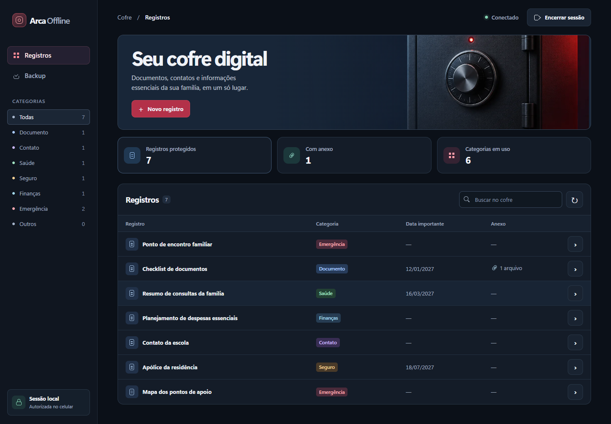
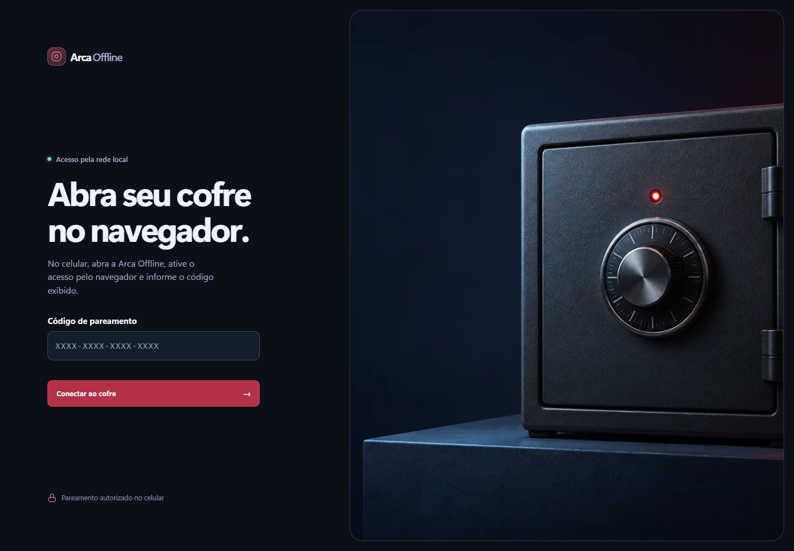
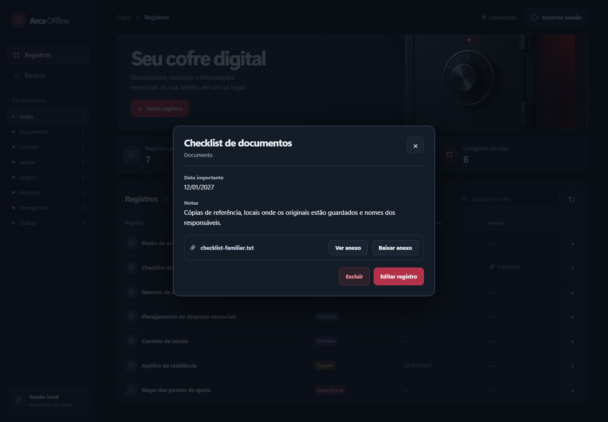
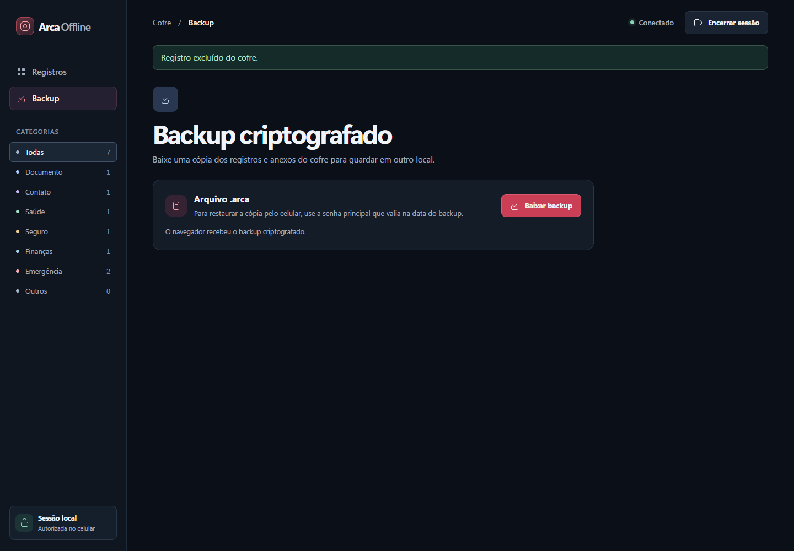
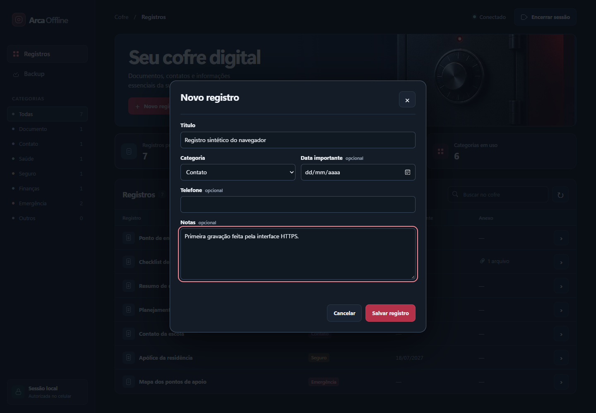
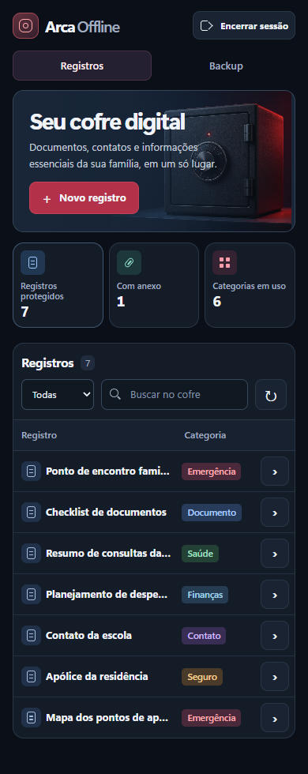

# Arca Offline 0.3.0

Cofre digital familiar para Android 8.0 ou superior. Guarde documentos, contatos e planos familiares no celular e gerencie o cofre pelo navegador de outro dispositivo na rede local. O Arca funciona sem conexão com a internet. [Conversa de origem](https://chatgpt.com/c/6af7d041-b66c-83e9-b103-908683f64357)

<div align="center">
  
  <br />
  <sub>Cofre aberto no navegador, com registros sintéticos usados na validação.</sub>
</div>

## O que o Arca guarda

- Até **350 registros** com título, categoria, notas, telefone e data importante. A busca ignora maiúsculas e acentos.
- Um anexo por registro de até **8 MiB**. O aplicativo oferece prévia de imagens, texto e PDFs compatíveis. O painel web exibe texto e imagens e baixa os demais anexos.
- Até **32 MiB** de conteúdo serializado no cofre. Anexos em Base64 ocupam aproximadamente um terço a mais que os arquivos originais.
- Backups `.arca` protegidos por senha. Os arquivos da versão 0.1 continuam compatíveis.

## Acesso web

1. Desbloqueie o cofre no Android e abra **Acesso web**. O outro dispositivo precisa estar na mesma rede Wi-Fi ou Ethernet.
2. Prepare o acesso HTTPS. Na primeira conexão, exporte o certificado público, verifique o SHA-256 e instale-o no navegador ou no dispositivo cliente.
3. Ative o acesso e abra o endereço mostrado no celular. Digite o código de uso único. Mantenha a tela **Acesso web** aberta enquanto usa o painel.

No navegador você pode buscar, filtrar, criar, editar e excluir registros, consultar anexos existentes e baixar o backup criptografado. O celular continua sendo a fonte dos dados. O acesso termina ao sair da tela do Android, perder a rede, encerrar a sessão ou atingir o prazo. As instruções por plataforma e a pesquisa de segurança estão no [guia de acesso web](docs/ACESSO_WEB.md).

## Instalação

1. Abra o APK de teste gerado em [app-debug.apk](app/build/outputs/apk/debug/app-debug.apk) no Android ou instale com `adb install -r app/build/outputs/apk/debug/app-debug.apk`.
2. Crie o cofre com uma senha principal de pelo menos 10 caracteres ou restaure um arquivo `.arca`. Guarde uma cópia da senha em um local seguro.
3. Para experimentar com dados fictícios, importe [backup-exemplo.arca](examples/backup-exemplo.arca) com a senha `ExemploArca2026!`. Use uma senha diferente para seus dados.

Antes de substituir uma instalação assinada com outra chave, exporte e valide um backup. O Android exige a mesma assinatura para atualizar um aplicativo instalado. A desinstalação apaga o cofre local.

## Backup e privacidade

- O cofre privado e os backups usam **AES-256-GCM**. Senhas novas usam **PBKDF2-HMAC-SHA256 com 600.000 iterações**.
- A restauração valida a senha, a integridade e o conteúdo antes de confirmar a substituição. Depois de mudar a senha ou restaurar o cofre, exporte e teste um novo backup.
- O Android bloqueia capturas de tela e exclui o cofre do backup automático do sistema. Exportar um anexo individual grava uma cópia descriptografada.
- O APK usa duas permissões de rede para o acesso web opcional. A senha principal fica no Android. O modo normal do cofre funciona em modo avião.
- A recuperação da senha depende das cópias que você guardar. Mantenha backups verificados de documentos críticos em suportes separados. A auditoria independente permanece pendente. [Segurança e backup](docs/SEGURANCA_E_BACKUP.md)

## Compilação

Use JDK 17, Android SDK Platform 35 e Build Tools 35.0.0. Defina `JAVA_HOME` e `ANDROID_HOME` ou selecione esses componentes no Android Studio. O Gradle Wrapper baixa o Gradle 8.9 com verificação de SHA-256.

```powershell
.\gradlew.bat :app:assembleDebug :app:assembleDebugAndroidTest :app:lintDebug
```

No Linux e macOS, use `bash ./gradlew` com as mesmas tarefas. Se o OneDrive bloquear arquivos intermediários no Windows, compile uma cópia local fora da sincronização. A compilação inicial pode precisar de internet. O workflow **Compilar APK de testes** também gera o artefato `arca-offline-debug-apk` no GitHub Actions.

## Testes

O workflow compila o APK e executa testes de criptografia, armazenamento, certificados e executa o lint do Android. O [relatório de validação](docs/RELATORIO_DE_TESTES.md) documenta o aparelho emulado, os testes Android, as operações feitas no navegador e o hash do APK entregue.

A instrumentação Android usa dados sintéticos e requer um emulador descartável em modo avião com instalação vazia. Depois de compilar os APKs, instale ambos no emulador e execute a suíte principal no Android 10 ou superior.

```text
adb install -r app/build/outputs/apk/debug/app-debug.apk
adb install -r app/build/outputs/apk/androidTest/debug/app-debug-androidTest.apk
adb shell am instrument -w br.com.arca.offline.test/br.com.arca.offline.ArcaSmokeInstrumentation
```

Acrescente `-e pdfOnly true` após `-w` para testar o visualizador em um emulador a partir do Android 8.0.

## 📸 Galeria

Capturas feitas no Edge com o painel servido pelo APK. Os registros são fictícios.

### Web

<table>
  <tr>
    <td width="50%" align="center">
      
      <br />
      <sub>Pareamento pela rede local</sub>
    </td>
    <td width="50%" align="center">
      
      <br />
      <sub>Detalhes e anexo de um registro</sub>
    </td>
  </tr>
  <tr>
    <td width="50%" align="center">
      
      <br />
      <sub>Backup criptografado</sub>
    </td>
    <td width="50%" align="center">
      
      <br />
      <sub>Criação de registro</sub>
    </td>
  </tr>
</table>

### Mobile

<div align="center">
  
  <br />
  <sub>Painel web em tela estreita.</sub>
</div>
